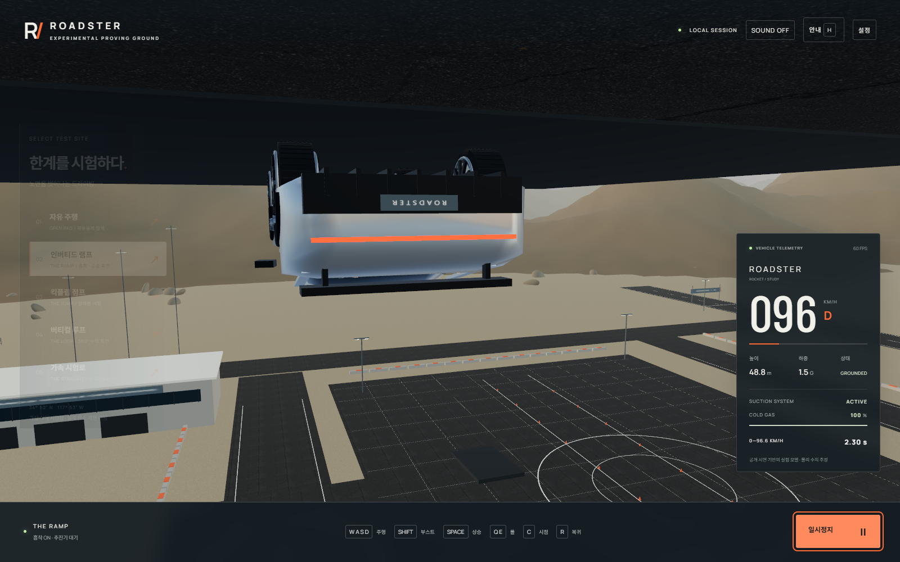

# ROADSTER / Proving Ground

신형 Tesla Roadster의 2026년 공개 시연을 참고한 브라우저 3D 주행 실험장입니다. 자유 주행, 흡착을 이용한 거꾸로 주행, 압축가스 추진, 공중 회전과 착지를 직접 조종할 수 있습니다.

**실차와 동일한 시뮬레이터는 아닙니다.** 제조사의 CAD, 질량 분포, 타이어 모델, 추력 곡선과 제어 소프트웨어가 없어 차량 형상과 물리 계수는 근사했습니다. 절차적으로 만든 차량·환경과 PBR 렌더링을 사용하며, 실사 스캔 기반의 AAA 그래픽은 아닙니다. 공개 자료와 구현상의 가정은 [docs/research.md](docs/research.md)에 구분했습니다.


## 실행

Node.js 22.12 이상과 WebGL 2를 지원하는 최신 Chrome 또는 Edge가 필요합니다.

Windows에서는 **`Start-Roadster.cmd`를 더블클릭**하면 설치 후 브라우저가 열립니다. 게임을 하는 동안 실행 창을 열어 두세요. 터미널로 실행하려면 다음 명령을 사용합니다.

```sh
npm ci
npm run dev
```

터미널에 표시되는 로컬 주소를 열고 **주행 시작**을 누릅니다. 설치 후 차량·지형·소리는 별도 외부 자산 요청 없이 작동합니다. 웹 폰트를 불러오지 못하면 시스템 글꼴을 사용합니다.

```sh
npm run build
npm run preview
```

배포 시 `dist/` 폴더를 정적 웹 서버에 올립니다. `file://`로 HTML을 직접 열지 않습니다.

## 시험 구역

| 번호 | 구역 | 구성 |
| --- | --- | --- |
| 1 | 자유 주행 | 스키드패드, 콘 슬라럼, 낮은 경사면 |
| 2 | 인버티드 램프 | 반경 25 m의 반쪽 루프, 50 m 높이의 거꾸로 끝나는 도로, 착지 표적 |
| 3 | 킥플립 점프 | 이륙 경사로, 5개 단단한 장애물, 높이 12 m 게이트와 착지 경사로 |
| 4 | 버티컬 루프 | 반경 23 m의 완전한 수직 루프 |
| 5 | 가속 시험로 | 약 700 m 직선, 거리 표시, 0–96.6 km/h 계측 |

시험장은 가상의 장소입니다. Mojave 좌표 표시는 분위기를 위한 위치 표기이며 Tesla의 McGregor 시설을 재현한 것이 아닙니다.

## 조작

| 키 | 기능 |
| --- | --- |
| W / ↑, S / ↓ | 가속, 제동 후 후진 |
| A D / ← → | 조향 |
| B | 뒷바퀴 핸드브레이크 |
| Shift + W | 전진 추진기 |
| Space | 차체 위쪽 방향으로 추진 |
| Q E | 공중 롤 |
| I K | 공중 피치 |
| 공중에서 A D | 공중 요 조작 |
| F | 흡착 팬 ON/OFF |
| T | 공중 수평 자세 안정화 |
| C | 추적, 범퍼, 오비트 카메라 |
| 마우스 드래그 | 카메라 각도 |
| R | 현재 구역 복귀와 가스 충전 |
| 1–5 | 시험 구역 이동 |
| Esc, H, M | 일시정지, 도움말, 소리 |

모바일에는 기본 주행·상승·부스트 터치 버튼이 있습니다. 공중 축별 조작은 키보드 사용을 권장합니다. 주행 중 다른 창으로 이동하면 자동으로 일시정지합니다.

램프에서는 팬을 켜고 80–110 km/h 정도로 진입해 보세요. 최고점에서 도로가 끝나면 떨어지며, Q/E로 회전하고 Space로 낙하를 조절할 수 있습니다. T는 실차에서 검증한 기능이 아닌 편의용 자세 안정화입니다. 일정한 속도로 진입하려면 W를 놓거나 S로 제동하세요.

설정에서 그래픽, 시간대, 흡착력, 상승 추력과 무한 가스를 바꿀 수 있습니다. 기본 모드에서 가스는 유한하며 공중에서 자동으로 채워지지 않습니다. 복귀 R로 충전합니다.

## 구현과 검증

Three.js의 금속·클리어코트 재질, HDR 반사, 태양광, 이동 그림자, MSAA와 블룸을 사용합니다. 정적 메시를 재질별로 합쳐 드로 콜을 줄였습니다. 사막 지형, 건물, 안내판과 자동차 형상은 코드로 생성합니다. 노면과 하늘 자산은 Poly Haven의 CC0 자산이며 [자산 출처](public/textures/CREDITS.md)에 기록했습니다.

Cannon-es의 강체, 레이캐스트 서스펜션과 네 바퀴 구동을 사용하며 120 Hz 고정 시간 간격으로 계산합니다. 곡선 도로는 실제 충돌체가 있고, 중력·추진력·가스 소모·차체 토크를 적분합니다. 차량을 정해진 애니메이션 경로로 이동시키지 않습니다. 흡착 팬은 바퀴가 노면을 감지하는 동안 차체 아래쪽으로 힘을 냅니다.



```sh
npm test
```

서스펜션, 가속·제동, 고체 충돌, 유한 가스, 부스트, 공중 회전, 복귀와 거꾸로 주행을 검증합니다.

```sh
# 먼저 별도 터미널에서 실행
npm run dev -- --port 5174
# Windows의 설치된 Edge로 UI 검증
node scripts/browser-qa.cjs
```

브라우저 테스트는 화면, 주행·상승, 복귀, 구역 선택, 설정, 도움말과 모바일 배치를 확인하고 `.test-artifacts/`에 결과를 저장합니다. 다른 포트는 `TEST_URL`, 다른 브라우저는 `BROWSER_CHANNEL` 환경변수로 지정합니다. Linux에서는 `npx playwright install chromium`이 필요할 수 있습니다.

## 현재 한계

- 실차 전용 3D 모델과 계측 자료가 없어 외관·운동 성능을 동일하게 보장하지 않습니다.
- 팬의 밀폐·지상고별 유량, 가스 압력·온도·질량 감소, 배터리·모터 열 모델은 구현하지 않았습니다.
- 타이어의 열·마모·변형, 차체 파손, 정확한 공기역학과 충돌 시 변형은 없습니다.
- 레이캐스트 바퀴와 분할 곡선 충돌체는 매우 빠른 속도나 모서리 충돌에서 실차와 다른 반응을 낼 수 있습니다.
- 계측 시간은 시뮬레이션 내부 시간이며, 실차 발표의 rollout이나 시험 조건을 재현하지 않습니다.
- 실차 조작법이나 실제 스턴트의 안전성을 판단하는 용도로 사용할 수 없습니다.

이 프로젝트는 Tesla와 관계없는 비공식 실험입니다.
