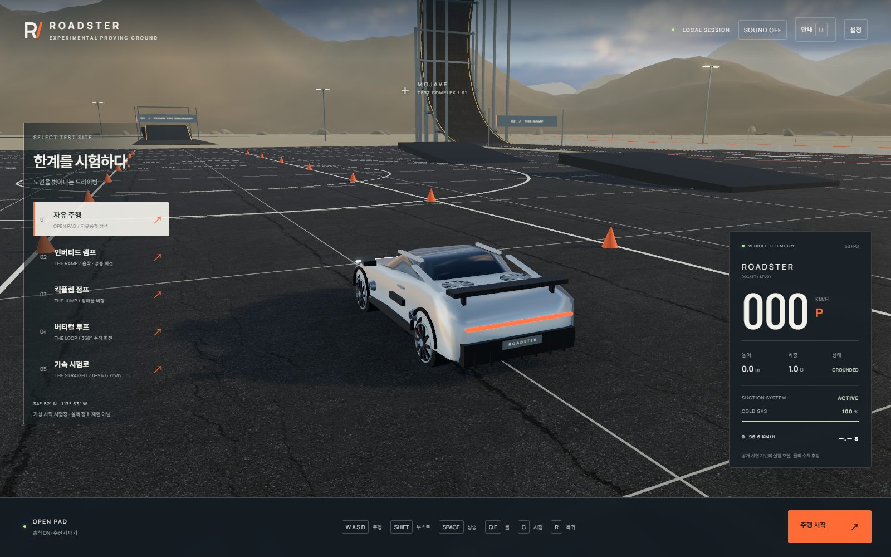
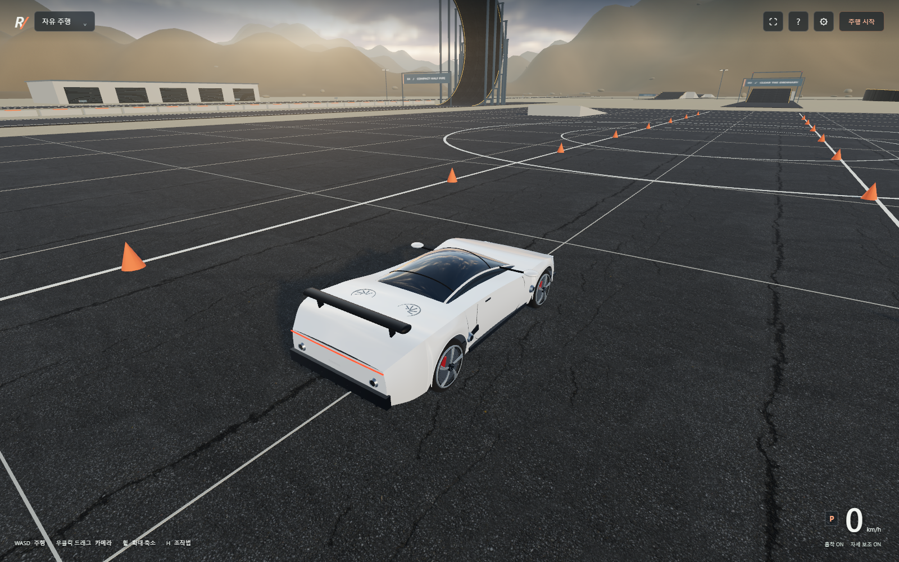
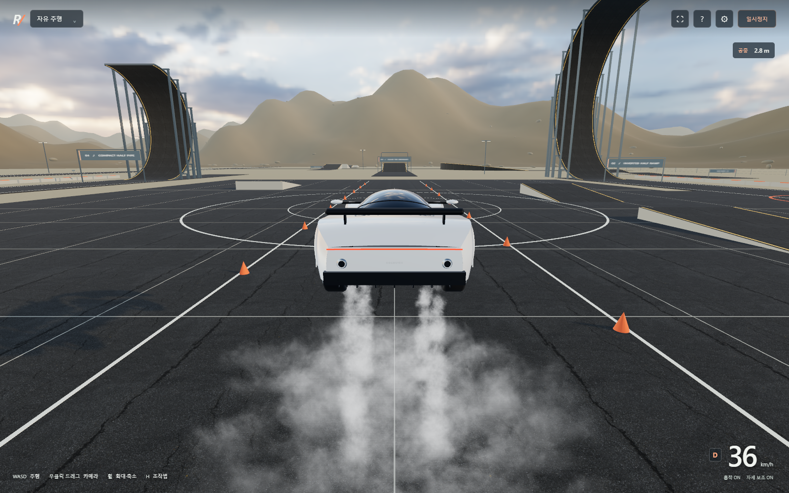

# ROADSTER / Proving Ground

공개된 신형 Roadster 시연을 참고한 브라우저 주행 실험장입니다. 흡착으로 수직 반원 도로를 달리고, 도로 끝에서 이탈한 뒤 추진기와 자세 조작으로 착지할 수 있습니다. 가스는 무제한입니다.

## 실행

Node.js 22.12 이상과 WebGL 2를 지원하는 Chrome 또는 Edge가 필요합니다.

Windows에서는 **Start-Roadster.cmd를 더블클릭**하세요. 필요한 의존성을 설치한 뒤 브라우저가 열립니다. 실행 창은 게임을 하는 동안 열어 둡니다.

~~~sh
npm ci
npm run dev
~~~

배포용 파일은 다음 명령으로 만듭니다. 정적 웹 서버에는 dist/를 올립니다.

~~~sh
npm run build
npm run preview
~~~

차량과 지형, 텍스처와 소리는 로컬에서 불러옵니다. 실행 중 외부 폰트나 CDN에 의존하지 않습니다.

## 조작과 카메라

| 입력 | 기능 |
| --- | --- |
| W / S 또는 ↑ / ↓ | 가속 / 제동. 멈춘 뒤 S를 계속 누르면 후진 |
| A / D 또는 ← / → | 좌우 조향 |
| B | 핸드브레이크 |
| Shift + W | 전진 부스트 |
| Space | 차체 위쪽 방향으로 추진 |
| Q / E | 공중에서 좌우 롤 |
| I / K | 공중에서 기수 올림 / 내림 |
| F / T | 흡착 / 공중 자세 보조 |
| 우클릭 드래그 | 차량 주변으로 카메라 회전 |
| 마우스 휠 | 4.2–100 m 범위 확대·축소 |
| C | 클래식 / 범퍼 시점 |
| End 또는 더블클릭 | 카메라를 차량 뒤로 정렬 |
| R / 1–9 / Tab | 현재 구역 복귀 / 구역 이동 / 시험장 메뉴 |
| Esc / H / U / M | 일시정지 / 도움말 / UI 숨김 / 소리 |

카메라는 [Roblox Classic](https://create.roblox.com/docs/workspace/camera)의 이동 추적과 수동 회전 방식을 참고했습니다. 우클릭을 누르고 움직인 픽셀 수가 회전각에 바로 반영됩니다. 마우스를 놓으면 회전이 멈추고, 차가 돌아도 선택한 각도를 유지합니다. 차량 뒤로 돌아가려면 End를 누릅니다. 설정에서 감도를 바꿀 수 있습니다.

회전 지연과 관성, 자동 재정렬, 속도에 따른 줌·화각 변화, 이동 방향으로 쏠리는 효과를 제거했습니다. 카메라는 보간된 차량 위치를 같은 프레임에 따라가고, 수직·거꾸로 주행 중에도 수평을 유지합니다. 벽이 가리면 거리를 줄입니다. 거꾸로 된 도로 아래처럼 카메라가 차체 안까지 밀려드는 곳에서는 선택한 시점을 유지하고 차량을 가리는 도로 부분에 작은 시야 창을 냅니다. 터치에서는 한 손가락 회전과 두 손가락 줌을 지원합니다.

속도와 흡착·자세 보조 상태만 작게 표시하고, 높이는 공중에서만 표시합니다. 시험장 목록과 자세한 조작법은 메뉴에서 엽니다. 전체 화면 버튼과 U로 화면을 더 넓게 쓸 수 있습니다.

## 시험장

| 번호 | 구역 | 지형 |
| --- | --- | --- |
| 1 | 자유 주행 | 넓은 패드, 콘 슬라럼, 낮은 경사로 |
| 2 | 인버티드 반원 | 반경 25 m의 수직 반원, 거꾸로 끝나는 도로와 착지 표적 |
| 3 | 킥플립 점프 | 이륙 경사로, 5개 장애물, 높이 게이트와 착지 경사로 |
| 4 | 컴팩트 반원 | 반경 16 m의 짧은 수직 반원 |
| 5 | 가속 시험로 | 약 700 m 직선 |
| 6 | 뱅크 코너 | 경사가 이어지는 180° 코너 |
| 7 | 연속 요철 | 높낮이가 완만하게 이어지는 물결 노면 |
| 8 | 갭 점프 | 두 가지 거리의 점프와 착지 경사로 |
| 9 | 핸들링 코스 | 지그재그 장애물과 제동 연습 |

수직 도로는 완전한 원이 아닌 반원입니다. 모든 경사로는 바닥까지 이어지는 입체 구조이며, 시각적 노면과 충돌체는 같은 좌표에서 만듭니다. 바위는 실제 지형 메시의 삼각형 높이를 기준으로 배치합니다.

## 차량과 분사 효과

차량은 곡면 차체, 열린 휠 아치, 타이어·브레이크·분리된 캘리퍼, 곡면 유리, 차체에 연결된 필러·거울과 스포일러로 구성했습니다. 바퀴·차체·노즐은 공통 차체 좌표를 사용합니다. 표시 위치를 계산할 때 물리 엔진의 접지 상태를 변경하지 않습니다.

가스는 원뿔이나 발광 불꽃 대신 노이즈를 적용한 증기 입자로 그립니다. 입자는 각 노즐에서 차량 속도를 이어받아 이동하고, 퍼진 뒤 사라집니다. 노면에 닿으면 접선 방향으로 퍼지며, 깊이 버퍼를 사용해 지형과 부드럽게 겹칩니다. 낮은 그래픽 설정에서는 깊이 사전 렌더링을 생략합니다.

차량 앞쪽은 +Z이며 +X는 운전자의 왼쪽입니다. A/←는 왼쪽, D/→는 오른쪽으로 핸들을 돌립니다. 속도가 높아지면 조향각을 줄이고 안팎 바퀴의 각도도 다르게 계산합니다. 키를 놓으면 핸들이 빠르게 중앙으로 돌아옵니다.

가속 키를 놓으면 모터 토크가 즉시 0이 됩니다. 공기저항은 속도의 제곱에 비례하고, 접지한 타이어에 구름저항과 회생제동을 적용해 감속합니다. 후진 중에도 같은 저항이 작동합니다. S는 먼저 제동하고 정지 후 잠시 계속 누르면 후진합니다. 공중에서는 타이어 제동이 작동하지 않으며, 공기저항과 중력이 계속 작용합니다. 공중 회전은 속도를 제한하고, 키를 놓으면 회전을 감쇠합니다. 자세 보조 T는 기본으로 켜져 있습니다.

## 검증

~~~sh
npm test
~~~

접지·가속·제동·관성 주행·후진·충돌·무제한 추진·공중 회전·반원 도로 주행을 검사합니다. 좌우는 네 가지 차량 방향에서 실제 카메라에 투영한 차체 앞뒤 위치로 확인합니다. 카메라는 입력과 회전의 일치, 30/120 Hz 응답, 자동 회전과 잔여 움직임 유무, 충돌 회피를 검사합니다.

~~~sh
# 별도 터미널
npm run dev -- --port 5174
# Windows의 설치된 Edge에서 브라우저 검사
node scripts/browser-qa.cjs
~~~

브라우저 검사는 빠른 드래그와 느린 드래그의 회전각, 손을 뗀 뒤 각도 유지, 휠 줌, 컨텍스트 메뉴 방지, 두 방향으로 배치된 차량의 화면상 좌우 조향, 가속 해제 후 감속, 공중 분사, 9개 구역과 반원 주행을 확인합니다. 결과와 캡처는 .test-artifacts/에 저장됩니다. 다른 주소는 TEST_URL, 브라우저는 BROWSER_CHANNEL로 지정합니다. Linux에서는 npx playwright install chromium이 필요할 수 있습니다.

## 자료와 한계

실차 CAD와 질량 분포, 타이어 곡선과 추진기 제어 로그가 없어 외형과 물리 계수는 근사했습니다. 실제 차량과 같은 성능이나 스캔 기반 실사 모델을 보장하지는 않습니다. 재현 범위와 자료는 [docs/research.md](docs/research.md), CC0 텍스처 출처는 [자산 출처](public/textures/CREDITS.md)에 기록했습니다.

팬의 밀폐·유량, 가스 압력·온도, 열과 타이어 마모, 차체 파손은 모델링하지 않습니다. 시험장은 가상 장소이며 Tesla McGregor 시설의 복제가 아닙니다. 이 프로젝트는 Tesla와 관계없는 비공식 실험입니다.
